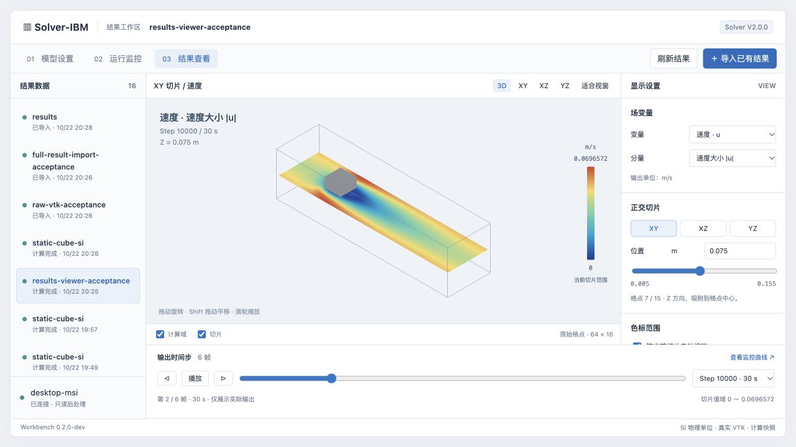

# 工作台 0.2.0-dev 结果查看验收

日期：2026-10-22。结果页已接入真实 V2.0.0 输出，供用户审核。所有修改位于 workbench/；未修改、编译或替换求解器。

## 数值与导入

- 16 项单元/服务契约测试通过，覆盖大端 float32、三分量 SCALARS、unsigned_char、X 优先的格点顺序、三个方向切片、格点中心坐标、抽样保留边缘、非有限值、截断/变化文件、混合网格、重复场、元数据不符、导入发布/取消与目录限制。
- Windows 实际算例 `results-viewer-acceptance`：`20261022T122532Z-cccfc1b1df14`，50,000 步，退出码 0、completion succeeded，输出 0/10000/20000/30000/40000/50000 共 6 帧。物理时间 0–150 s；64 × 16 × 16 格点，dx=0.01 m，域为 0.64 × 0.16 × 0.16 m。
- 将 API 返回切片与原始 VTK 二进制独立逐点比较：速度大小及 XYZ 分量、p、rho、flags，三个切面，共 21 组，最大绝对差 1.3877787807814457e-17（速度模长计算的浮点舍入）。检查坐标和步号，不以截图替代数值核验。
- 完整 VTK 时间序列、effective/resolved-config 与 STL 上传导入通过；时间、SI 单位、几何变换和 STL SHA256 保留。仅 u 文件导入时正确显示未知单位/时间。缺失场明确返回 404，不偷换为另一帧或另一变量。
- 报告：[results-acceptance-20261022.json](results-acceptance-20261022.json)。复现入口：`tests/check_results_live.py --run-id <已有任务ID> --report <报告文件>`，只读取已有 Windows 输出并建立独立导入，不启动本地求解器。

## 浏览器

Mac 浏览器通过 SSH 隧道访问 Windows 服务，实际验证：

- 从“开始运行”提交 400 步算例 `20261022T122600Z-8aa9162a20a6`，完成后自动切换到对应结果页，加载第 400 步 / 1.2 s 速度云图和 STL。
- XY/XZ/YZ 切面、速度分量与压力切换、切片位置输入（0.085 m 对应第 8 个格点）、三维/正交视角、适合视窗、STL 显隐和透明度、跨时间保持固定色标范围。
- 6 帧实际输出的时间选择、播放与暂停；画面标签、步号、物理时间和值域同步变化。离散标记使用不插值色块，隐藏连续色标控件。
- 通过“导入已有结果”窗口读取 Windows 结果目录，得到独立导入记录并渲染。Mac 多文件/目录上传的数据接口由上述真实文件上传验收覆盖，本轮未再次操作系统文件选择器。
- 浏览器渲染使用本地 vtk.js bundle，不依赖 CDN。发现的相机边界传参、视窗占比与切片输入反馈问题均已修正。

## 保留的边界

支持 V2.0.0 BINARY STRUCTURED_POINTS 均匀网格。单张切片每轴最多 257 个原始格点；超过时明确标记抽样预览。首版静态 STL 叠加按原始文件与该次计算的变换对齐；动态对象隐藏并说明原因。动态位姿、斜切面、流线、体渲染、任意 VTK 格式仍未实现。

这是工作台后处理与小算例验收，不代表对求解器做了新的完整数值模型回归。原 V2.0.0 正式 EXE SHA256 保持 `3ab5c696aa38e5fd919a6b1236e0b330347058a097f99f40b2a606d3d908c4cd`。原草稿和正式包保持原状。

运行代码提交：`e1fcb4d`，后续提交仅整理验收记录和截图。部署后再次确认正式 EXE SHA256 未改变、工作台无活动任务、两类已导入数据在服务重启后可恢复。审核所需 Windows 服务及一条本会话的 SSH 预览隧道保留；本轮部署/检查用临时 SSH 会话均已退出。
