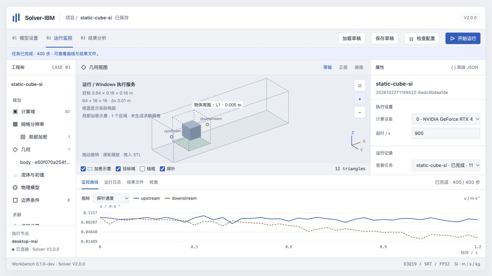

# 工作台 0.1.0-dev 验证记录

日期：2026-10-22。结论：浏览器 → SSH 回环转发 → Windows 执行服务 → 正式 Solver-IBM V2.0.0 的首版流程已跑通，供用户试用审核；不是新的求解器正式版本。

## 版本与环境

- 工作台运行代码：`f6da235`；后续提交仅补充测试、说明、验收记录和截图。
- 求解器基线：`v2.0.0` / `58f44e5013b7b1ffe105107cfa2a27f8d557e45d`。相对基线只新增 `workbench/`，求解器、原构建脚本和算例文件未修改。
- 执行程序：原正式包 `package/V2.0.0/bin/Solver-IBM.exe`，实际 `--version` 为 `Solver-IBM 2.0.0`。
- EXE SHA256：`3ab5c696aa38e5fd919a6b1236e0b330347058a097f99f40b2a606d3d908c4cd`。
- 正式构建提交：`a039a20d32dd4571ebfcd27cd8125c77f7b049f4`；源码树：`b3b27571e3578e6237986260b1dcbee8774702da`。构建提交早于最终打包标签，保持原发布包记录。
- desktop-msi：Windows、Python 3.12.10；本轮实际枚举设备 0 为 NVIDIA GeForce RTX 4070 Ti SUPER / driver 610.88，设备 1 为 AMD gfx1036。真实计算使用设备 0。
- Mac 只运行浏览器、工具和假执行器测试，没有运行或编译求解器。

## 自动与真实运行验证

Mac 的 10 项服务契约测试通过：快照隔离和完成状态、单任务互斥与终止、超时与失败、配置检查清理、草稿版本冲突、路径限制与排除功能、STL 格式检查、交错 CSV 与不完整末行、同秒任务顺序、HTTP 会话及来源检查。

`node --check workbench/web/app.js`、Mac 启动脚本语法检查通过。前端源文件与已提交生成文件一致。

Windows 的 `tests/smoke_windows.py` 通过 9 项实际服务验收：STL 上传、正式程序校验、越界路径拒绝、局部加密配置拒绝、续算配置拒绝、主动终止、超时、无效输入失败、23 步真实计算及 CSV/VTK/配置快照下载。原始报告保存在 Windows `workingdir/web-workbench/acceptance-20261022.json`；本目录 [验收 JSON](acceptance-20261022.json) 补充了浏览器与服务生命周期检查。

23 步任务：`20261022T100902Z-e29425109011`，退出码 0、`completion.json` 为 succeeded。monitor 记录第 23 步；analysis/probes/forces 按 every=7 记录 0、7、14、21 步。工作台不伪造第 23 步探针数据。实际生成并提供下载的末步 VTK 包含 u、rho、p、flags。

## 浏览器验收

使用 Mac 上的真实工作台页面完成：

- 格距从 0.01 改为 0.0125 m，显示 52 × 13 × 13，实际域 0.65 × 0.1625 × 0.1625 m；目标域仍为 0.64 × 0.16 × 0.16 m，STL 尺寸 0.06 m、中心 [0.16, 0.08, 0.08] m 均不变。高级 JSON 同步确认。
- 通过高级 JSON 改回格距并设置步数，表单同步更新。将 xmin 改为运动壁面，法向速度禁止编辑，设置切向速度 [0, 0.02, 0] m/s；xmax 自动改为无滑移，Y/Z 周期保留。生成 JSON 通过 Windows 正式程序校验。
- 保存草稿，直接点击“开始运行”；`browser-acceptance` 任务 `20261022T101036Z-378ee6150262` 完成 400 步，退出码 0，页面读取真实速度曲线、日志和文件列表。
- 网页选择本地二进制 STL，实际上传到 Windows，返回带内容哈希的 assets 路径，预览与整对象属性保持可用。
- 恢复周期边界作为试用算例，保存 `static-cube-si`，再次从网页提交已上传 STL：任务 `20261022T114952Z-6adc4bdea1de` 完成 400 步，退出码 0。已修正提交与轮询交错时混入上一任务日志的问题；下拉任务状态、完成步数和曲线一致。
- 页面刷新及服务正常关闭/重启后，服务器草稿、历史任务与结果可恢复；浏览器控制台未发现脚本错误。

当前留给用户的草稿为 `static-cube-si`：400 步、每 10 步监测，STL 使用网页已上传的资源。图中局部加密为预留区域示意；运行快照明确 `applied: false`，求解器输入没有局部加密字段。

## 服务与连接

后台服务通过 Windows `Win32_Process.Create` 独立启动，启动 SSH 会话退出后仍可访问并完成实际计算。普通 Start-Process 会被 Windows OpenSSH 回收，因此不再用它承载后台服务。无需注册开机任务、修改防火墙或创建新凭据。

`stop-windows.ps1` 已验证正常关闭；随后 `start-windows.ps1 -Background` 已验证重新启动并保留历史。计算中的服务关闭请求会被拒绝，需要先在页面终止任务。工作台不提供续算。

数据和日志全部位于包外 `workingdir/web-workbench/`；原正式包的 EXE 及构建记录只读使用。连接脚本只监听 Mac/Windows 的 127.0.0.1；每次计算使用独立 EXE 和输入快照，终止仅作用于所属 Windows Job Object。

## 本次验证范围

这是工作台接入与小算例验收，不代替传热、自由液面和运动模型的完整数值回归验证。相关表单沿用已审核的 V2.0.0 功能映射，运行前仍由正式程序校验。首版是单用户、单活动任务、手动启动的开发版；没有多用户权限、开机自启、任务排队或结果三维场渲染。

局部加密只有草稿接口；编译、参数扫描、续算以及 STL 分面属性不在此版范围内。
